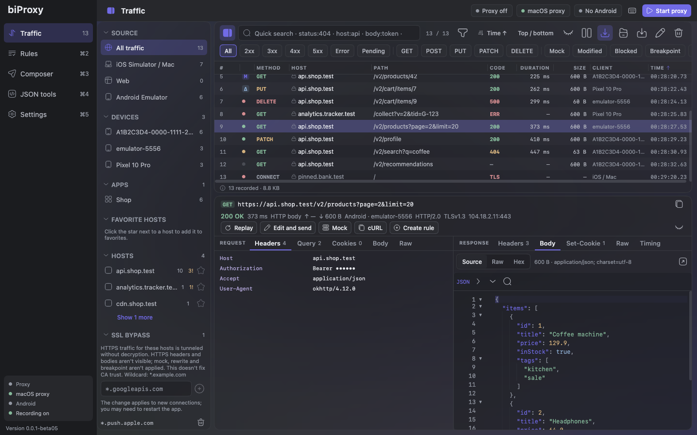
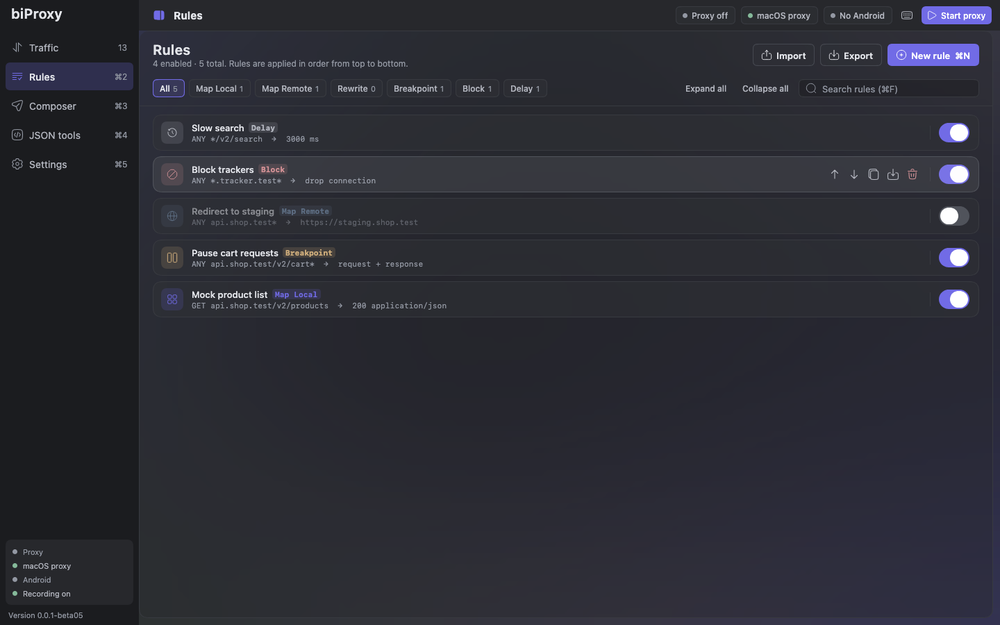
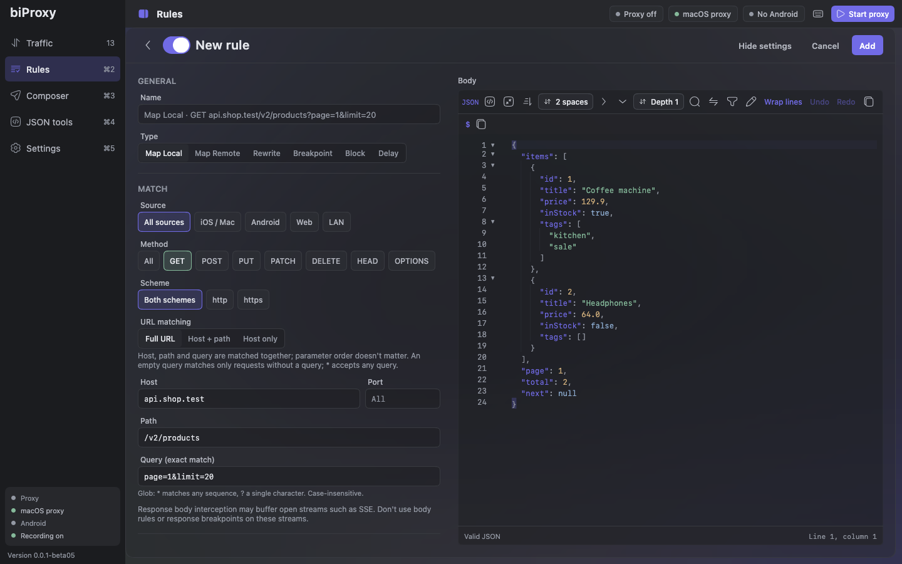
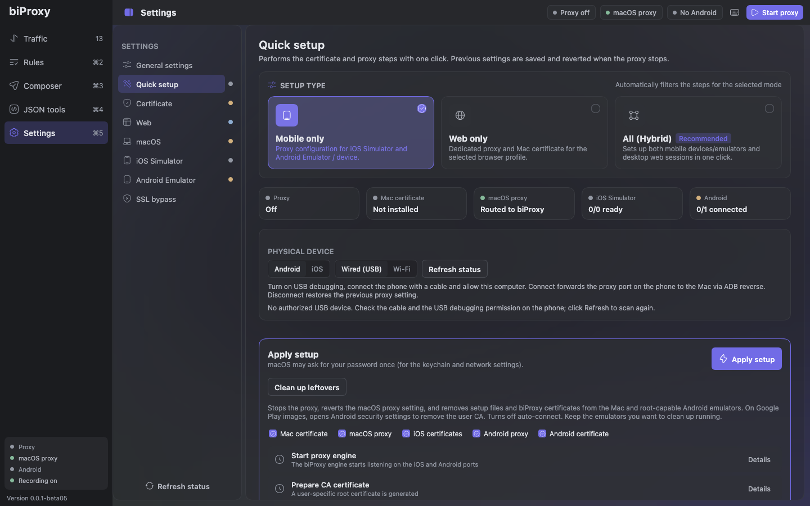
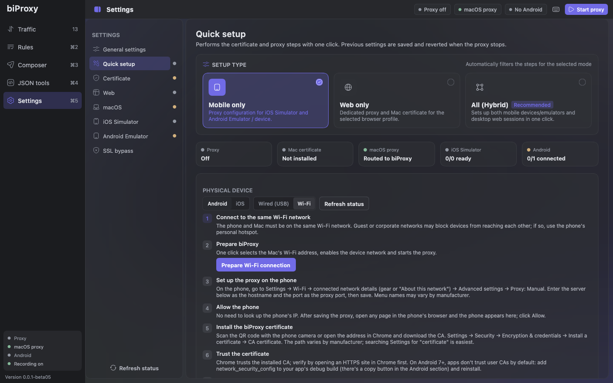
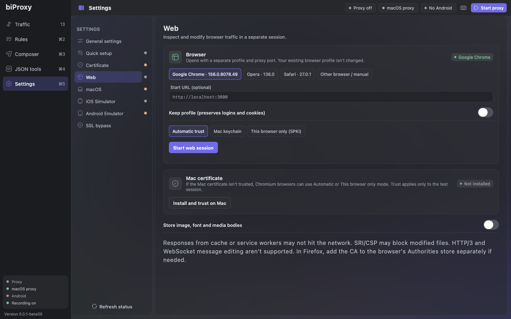
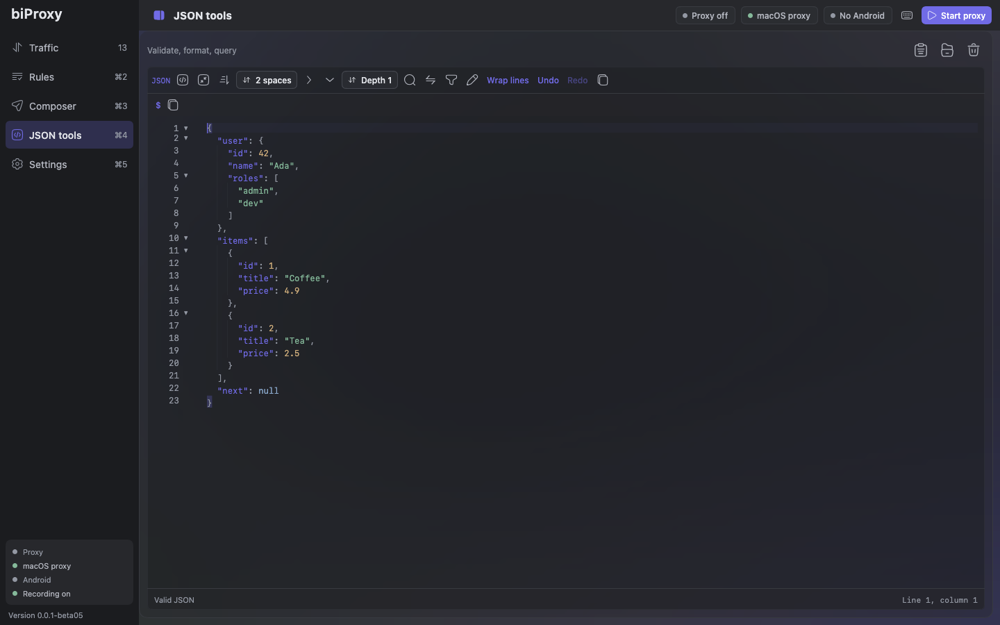
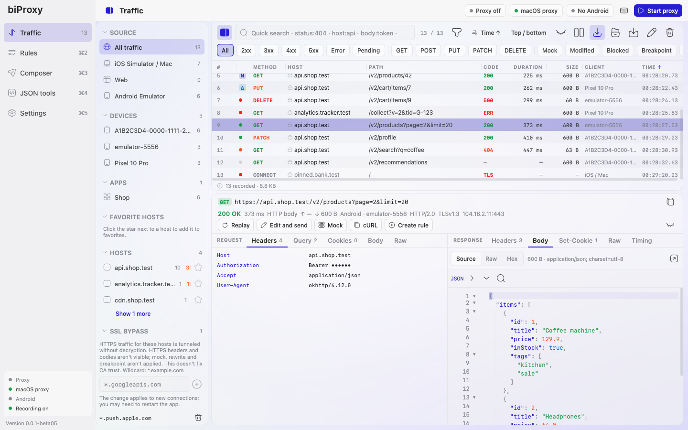
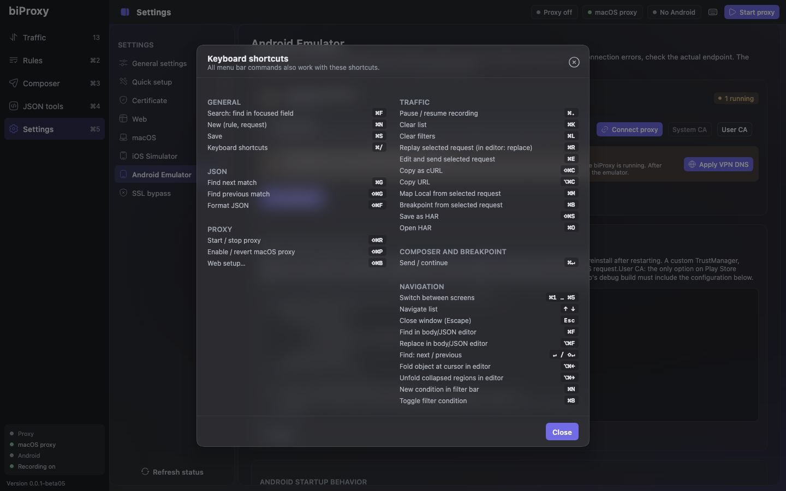

<div align="center">


# biProxy

**A native macOS HTTP/HTTPS debugging proxy built for mobile and web developers.**

Capture, decrypt, inspect, modify and replay traffic from the iOS Simulator, Android Emulator,<br>
real devices and browsers — set up with a single click.

**English** · [Türkçe](README.tr.md)

[Website](https://biproxy.pages.dev)

[](https://github.com/ahmet-ozberk/biProxy-version/releases)
[](https://github.com/ahmet-ozberk/biProxy-version/releases)
[](https://github.com/ahmet-ozberk/biProxy-version/releases)


### [⬇️ Download the latest version](https://github.com/ahmet-ozberk/biProxy-version/releases)



</div>

## Why biProxy?

General-purpose proxies answer *"what did my app send, and what came back?"* — but leave a lot of manual work in a
mobile developer's day. biProxy removes it:

- **One-click setup.** macOS proxy, Mac keychain, iOS Simulator and Android Emulator (including the Android 14+
  Conscrypt APEX store) are configured automatically, and reverted when you stop.
- **Device and app aware.** Every Android emulator gets its own port and iOS connections are attributed to the
  process, so you always know which device and which app made a request.
- **Safe by default.** Only iOS Simulator traffic is decrypted; your browser, Gradle and Android Studio keep working
  without certificate warnings. If biProxy crashes, a watchdog restores your Mac's proxy settings.
- **Mock, rewrite, pause.** Turn any captured response into a mock, script failure sequences, or stop requests
  mid-flight and edit them.

## Features

| | |
| --- | --- |
| 📡 **Capture** | HTTP/1.1, HTTP/2 (ALPN), TLS MITM, WebSocket and SSE. Selective decryption with an SSL bypass list. |
| 🔍 **Inspect** | Resizable table, source/device/app sidebar, condition-based filters, quick search (`status:404 host:api body:token`), JSON tree, hex, image preview, timing, TLS details and semantic diff. |
| 🎭 **Rules** | Map Local (with sequential scenarios), Map Remote, Rewrite (regex), Breakpoint, Block and Delay. Create a rule from any request in one click; import/export as portable JSON. |
| ⏸️ **Breakpoints** | Pause requests and responses, edit method, URL, headers, body or status, then continue, pass through or abort. |
| 🧪 **Composer** | Build requests from scratch or from captured traffic, with environments, cURL import, code generation and history. |
| 🌐 **Network conditions** | Bandwidth limits, latency, jitter and connection drops per host, path or device. |
| 📲 **Real devices & web** | Android over USB (`adb reverse`) or Wi-Fi with an IP allowlist and QR code; isolated Chrome, Opera and Firefox sessions. |
| 📤 **Share** | HAR import/export and bug bundles with tokens, cookies and signed URLs masked. |
| 🤖 **Automation** | Headless CLI and MCP server for CI pipelines and AI agents. |
| 🍎 **Native macOS** | Menu bar, tray with live traffic summary, light/dark themes, text sizes, English and Turkish UI. |
| 🔄 **Auto update** | Checks for new versions in the background and installs them with one click, after verifying signatures. |

## Screenshots

| Rules | Mock from a captured response |
| :---: | :---: |
|  |  |
| **One-click setup** | **Real devices over Wi-Fi** |
|  |  |
| **Browser sessions** | **JSON tools** |
|  |  |
| **Light theme** | **Keyboard-first** |
|  |  |

## Installation

1. Open [Releases](https://github.com/ahmet-ozberk/biProxy-version/releases) and download
   `biProxy-<version>-macos-arm64.dmg` from the newest release.
2. Open the DMG and drag **biProxy** into *Applications*.

Packages are signed with a Developer ID and notarized by Apple, so macOS opens them without extra prompts. The Java
runtime is bundled; nothing else needs to be installed.

**Requirements:** macOS on Apple Silicon. Intel packages will be listed as `macos-x64` once published. Xcode Command
Line Tools are needed for iOS Simulator setup, and Android SDK Platform-Tools (`adb`) for Android devices.

## Quick start

### iOS Simulator

1. Boot a simulator.
2. In biProxy, open **Settings → Quick setup** and click **Apply setup**.
3. Approve the macOS prompt. The proxy starts, the CA is trusted on your Mac and on running simulators, and the
   macOS proxy is enabled.
4. Relaunch your app — requests show up in **Traffic**.

### Android Emulator

1. Start an emulator. A rootable AOSP / Google APIs image gives fully automatic setup; Play Store images need one
   confirmation on the device.
2. Run **Quick setup**. The emulator gets a global proxy (`10.0.2.2:<port>`) and the biProxy CA.
3. Let your debug build trust user CAs:

```xml
<network-security-config>
    <debug-overrides>
        <trust-anchors>
            <certificates src="user" />
            <certificates src="system" />
        </trust-anchors>
    </debug-overrides>
</network-security-config>
```

### Mock a response

Select a request in **Traffic** and click **Mock**. The response opens, formatted, in the rule editor — change the
body or status code and save. Subsequent requests get your response without hitting the server.

## Updates

biProxy checks for updates 10 seconds after launch and then once a day (can be turned off in
**Settings → General → Updates**). When a new version is available, **Restart and install** replaces the app and
reopens it; if anything goes wrong, the previous version is restored.

Beta versions are published as **Pre-release** on GitHub. Each release contains:

| File | Purpose |
| --- | --- |
| `biProxy-<version>-macos-arm64.dmg` | First installation |
| `biProxy-<version>-macos-arm64.zip` | In-app update package |
| `*.sha256` | SHA-256 checksum of each package |

To verify a download manually:

```bash
shasum -a 256 -c biProxy-<version>-macos-arm64.dmg.sha256
```

### How updates are verified

- The app reads a single feed: [`feed/v1/feed.json`](feed/v1/feed.json), signed with Ed25519
  ([`feed.json.sig`](feed/v1/feed.json.sig)). The feed is ignored unless the signature matches the public key
  embedded in the app.
- The downloaded ZIP is checked against the size and SHA-256 in the feed, then `codesign`, Gatekeeper, bundle ID,
  version and Team ID are compared with the running app before anything is installed.
- Update requests bypass the system proxy, so they work even while biProxy itself is the system proxy.

Feed public key (Ed25519, X.509 DER / Base64):

```text
MCowBQYDK2VwAyEAcPcFhxKFGVNMfhW8lYeSTX8w1o1icRVur3ssOlEYLQU=
```

The private signing key is never stored in this repository. The legacy `update.json` file and the `v1.0.0-beta01`
release are kept unchanged for older installations.

## Security

- The local CA uses an EC P-256 key stored with `0600` permissions; leaf certificates are short-lived.
- Upstream server certificates and host names are always verified — interception happens only on the client side.
- Listeners bind to loopback. The LAN listener for real devices is opt-in and limited by an IP allowlist.
- Imported rules cannot read local files through Map Local.

## Known limitations

- WebSocket extensions, WebSocket over HTTP/2 and cleartext HTTP/2 (`h2c`) are not supported.
- Intercepted (rule-matched) bodies are capped at 8 MiB; all other traffic is streamed.
- Apps using certificate pinning, a custom TrustManager or ignoring the system proxy need extra configuration.

## Feedback

Found a bug or have a feature request? Open an
[issue](https://github.com/ahmet-ozberk/biProxy-version/issues) — please include your biProxy version
(**Settings → General → Updates**), macOS version and steps to reproduce.
