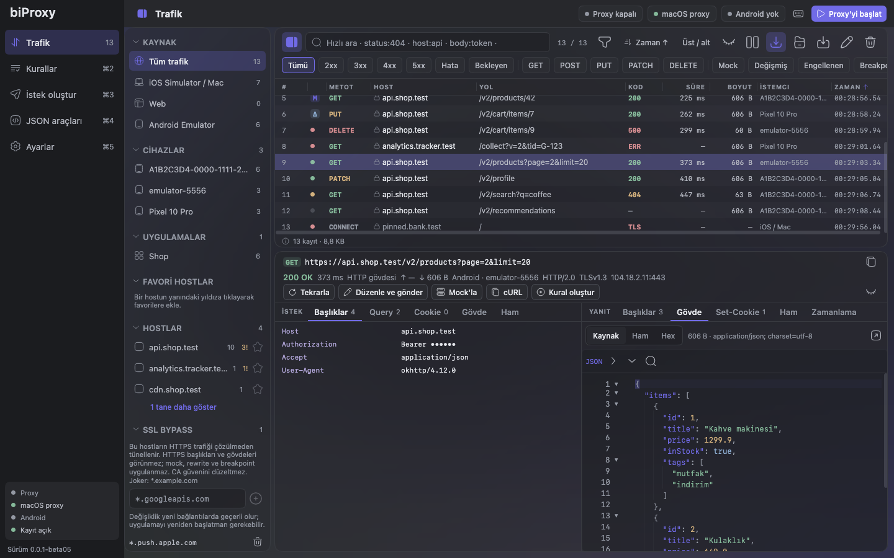
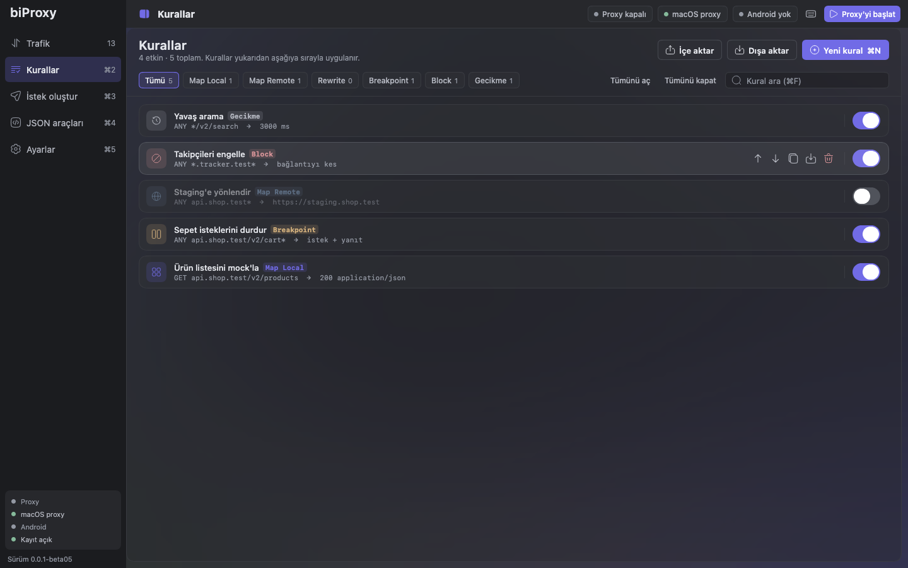
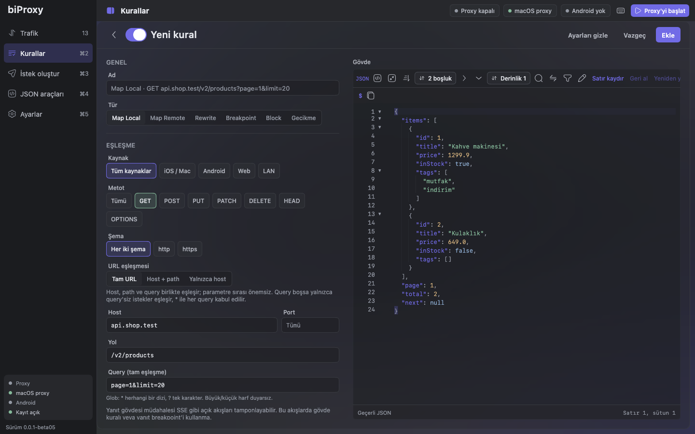
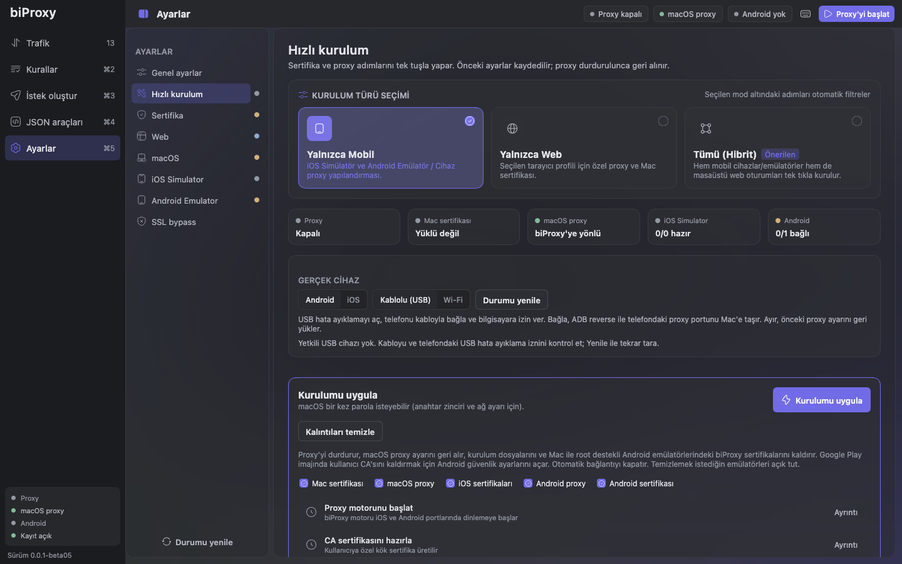
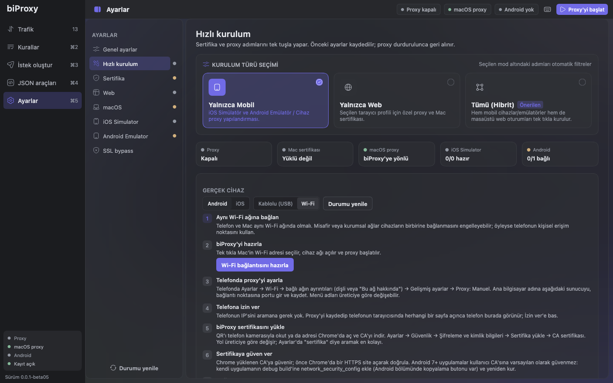
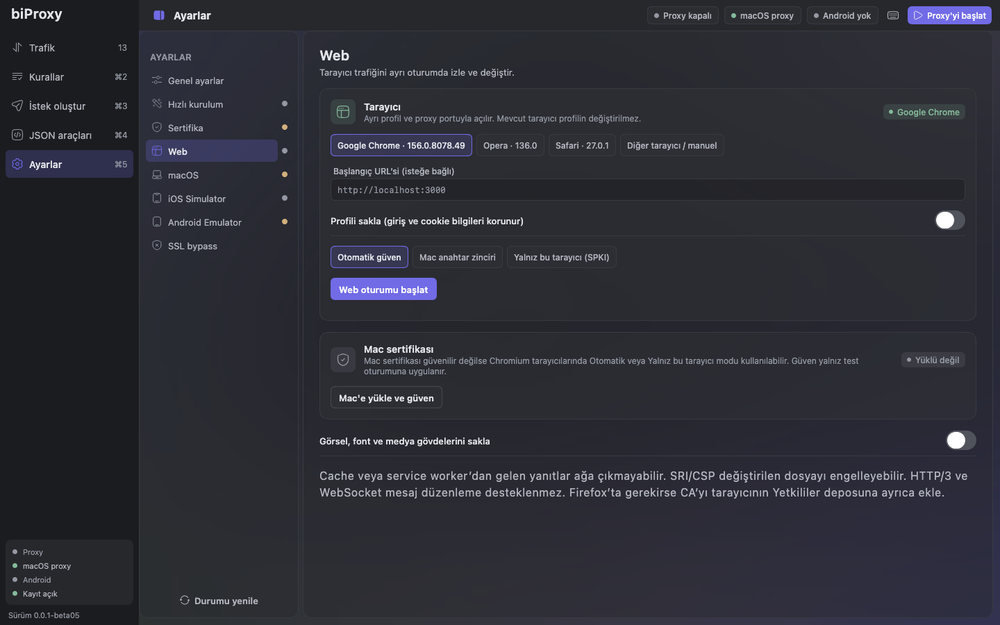
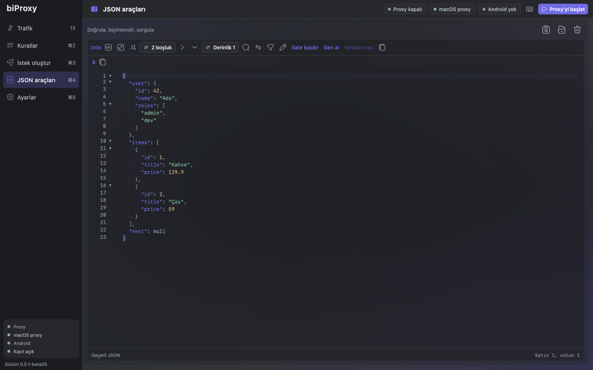
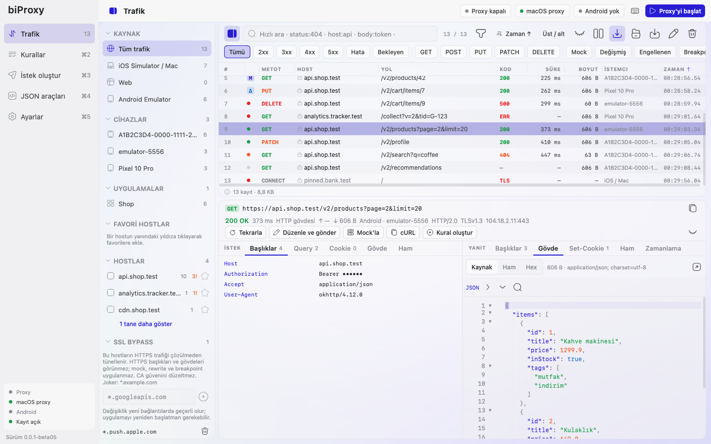
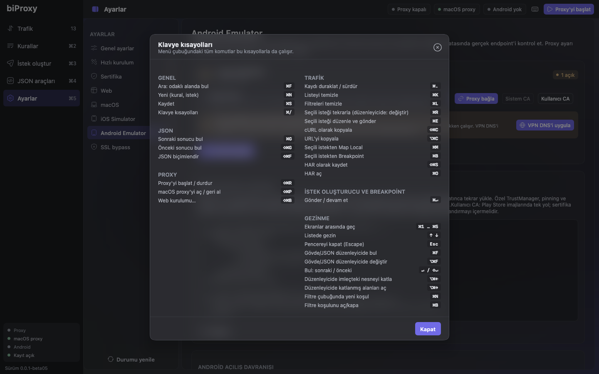

<div align="center">


# biProxy

**Mobil ve web geliştiricileri için native macOS HTTP/HTTPS debugging proxy'si.**

iOS Simulator, Android Emulator, gerçek cihazlar ve tarayıcılardan gelen trafiği yakala, çöz, incele,<br>
değiştir ve tekrar oynat — tek tıkla kurulum.

[English](README.md) · **Türkçe**

[](https://github.com/ahmet-ozberk/biProxy-version/releases)
[](https://github.com/ahmet-ozberk/biProxy-version/releases)
[](https://github.com/ahmet-ozberk/biProxy-version/releases)


### [⬇️ Son sürümü indir](https://github.com/ahmet-ozberk/biProxy-version/releases)



</div>

## Neden biProxy?

Genel amaçlı proxy araçları *"uygulamam ne gönderdi, ne geri geldi?"* sorusunu cevaplar, ama mobil geliştiricinin
gününde çok fazla elle iş bırakır. biProxy bu işleri ortadan kaldırır:

- **Tek tıkla kurulum.** macOS proxy'si, Mac anahtar zinciri, iOS Simulator ve Android Emulator (Android 14+
  Conscrypt APEX deposu dahil) otomatik ayarlanır; proxy durunca eski haline döner.
- **Cihaz ve uygulama farkındalığı.** Her Android emülatörü ayrı port alır, iOS bağlantıları sürece göre eşleştirilir;
  hangi isteğin hangi cihazdan ve uygulamadan geldiği her zaman bellidir.
- **Varsayılan olarak güvenli.** Yalnız iOS Simulator trafiği çözülür; tarayıcı, Gradle ve Android Studio sertifika
  uyarısı vermeden çalışmaya devam eder. biProxy çökse bile bekçi süreç Mac'in proxy ayarlarını geri yükler.
- **Mock'la, değiştir, durdur.** Yakalanan her yanıtı mock'a çevir, hata senaryoları kur ya da istekleri yolda
  durdurup düzenle.

## Özellikler

| | |
| --- | --- |
| 📡 **Yakalama** | HTTP/1.1, HTTP/2 (ALPN), TLS MITM, WebSocket ve SSE. SSL bypass listesiyle seçici şifre çözme. |
| 🔍 **İnceleme** | Boyutlandırılabilir tablo, kaynak/cihaz/uygulama kenar çubuğu, koşullu filtreler, hızlı arama (`status:404 host:api body:token`), JSON ağacı, hex, görsel önizleme, zamanlama, TLS ayrıntıları ve anlamsal karşılaştırma. |
| 🎭 **Kurallar** | Map Local (sıralı senaryolarla), Map Remote, Rewrite (regex), Breakpoint, Block ve Gecikme. Her istekten tek tıkla kural; taşınabilir JSON ile içe/dışa aktarma. |
| ⏸️ **Breakpoint** | İstek ve yanıtları durdur; metot, URL, başlık, gövde veya durum kodunu düzenleyip devam ettir, değiştirmeden geçir ya da iptal et. |
| 🧪 **İstek oluşturucu** | Sıfırdan ya da yakalanan trafikten istek hazırla; ortam değişkenleri, cURL içe aktarma, kod üretimi ve geçmiş. |
| 🌐 **Ağ koşulları** | Host, yol veya cihaza göre bant genişliği sınırı, gecikme, jitter ve bağlantı kesme. |
| 📲 **Gerçek cihaz ve web** | USB (`adb reverse`) ya da IP izin listesi ve QR kodla Wi-Fi üzerinden Android; ayrı profilli Chrome, Opera ve Firefox oturumları. |
| 📤 **Paylaşım** | HAR içe/dışa aktarma; token, cookie ve imzalı URL'leri maskelenmiş hata paketleri. |
| 🤖 **Otomasyon** | CI hatları ve yapay zekâ ajanları için arayüzsüz CLI ve MCP sunucusu. |
| 🍎 **Native macOS** | Menü çubuğu, canlı trafik özetli durum menüsü, açık/koyu tema, yazı boyutları, Türkçe ve İngilizce arayüz. |
| 🔄 **Otomatik güncelleme** | Yeni sürümleri arka planda kontrol eder, imzaları doğruladıktan sonra tek tıkla kurar. |

## Ekran görüntüleri

| Kurallar | Yakalanan yanıttan mock |
| :---: | :---: |
|  |  |
| **Tek tıkla kurulum** | **Wi-Fi ile gerçek cihaz** |
|  |  |
| **Tarayıcı oturumları** | **JSON araçları** |
|  |  |
| **Açık tema** | **Klavye kısayolları** |
|  |  |

## Kurulum

1. [Releases](https://github.com/ahmet-ozberk/biProxy-version/releases) sayfasını aç ve en yeni sürümden
   `biProxy-<sürüm>-macos-arm64.dmg` dosyasını indir.
2. DMG'yi aç ve **biProxy**'yi *Uygulamalar* klasörüne sürükle.

Paketler Developer ID ile imzalı ve Apple tarafından onaylıdır (notarized); macOS ek onay istemeden açar. Java
runtime paketin içindedir; başka bir şey kurmana gerek yoktur.

**Gereksinimler:** Apple Silicon işlemcili macOS. Intel paketleri yayımlandığında `macos-x64` adıyla listelenir.
iOS Simulator kurulumu için Xcode Command Line Tools, Android cihazlar için Android SDK Platform-Tools (`adb`) gerekir.

## Hızlı başlangıç

### iOS Simulator

1. Bir simülatör aç.
2. biProxy'de **Ayarlar → Hızlı kurulum** ekranına git ve **Kurulumu uygula**'ya tıkla.
3. macOS yetki istemini onayla. Proxy başlar, CA Mac'e ve açık simülatörlere güvenilir olarak eklenir, macOS
   proxy'si açılır.
4. Uygulamanı yeniden başlat — istekler **Trafik** ekranında görünür.

### Android Emulator

1. Bir emülatör başlat. Root destekleyen AOSP / Google APIs imajlarında kurulum tamamen otomatiktir; Play Store
   imajlarında cihazda bir onay gerekir.
2. **Hızlı kurulum**'u çalıştır. Emülatöre global proxy (`10.0.2.2:<port>`) ve biProxy CA'sı kurulur.
3. Debug derlemenin kullanıcı CA'larına güvenmesini sağla:

```xml
<network-security-config>
    <debug-overrides>
        <trust-anchors>
            <certificates src="user" />
            <certificates src="system" />
        </trust-anchors>
    </debug-overrides>
</network-security-config>
```

### Bir yanıtı mock'lamak

**Trafik** ekranında isteği seç ve **Mock'la**'ya tıkla. Yanıt biçimlendirilmiş olarak kural editöründe açılır —
gövdeyi veya durum kodunu değiştirip kaydet. Sonraki istekler sunucuya gitmeden bu yanıtı alır.

## Güncellemeler

biProxy açılıştan 10 saniye sonra ve ardından günde bir kez güncelleme kontrol eder (**Ayarlar → Genel →
Güncellemeler**'den kapatılabilir). Yeni sürüm varsa **Yeniden başlat ve kur** uygulamayı değiştirip yeniden açar;
bir sorun çıkarsa önceki sürüm geri yüklenir.

Beta sürümler GitHub'da **Pre-release** olarak yayımlanır. Her release şu dosyaları içerir:

| Dosya | Amaç |
| --- | --- |
| `biProxy-<sürüm>-macos-arm64.dmg` | İlk kurulum |
| `biProxy-<sürüm>-macos-arm64.zip` | Uygulama içi güncelleme paketi |
| `*.sha256` | Her paketin SHA-256 özeti |

İndirilen dosyayı elle doğrulamak için:

```bash
shasum -a 256 -c biProxy-<sürüm>-macos-arm64.dmg.sha256
```

### Güncellemeler nasıl doğrulanır?

- Uygulama tek bir feed okur: Ed25519 ile imzalanmış [`feed/v1/feed.json`](feed/v1/feed.json)
  ([`feed.json.sig`](feed/v1/feed.json.sig)). İmza uygulamaya gömülü public key ile eşleşmezse feed kullanılmaz.
- İndirilen ZIP, feed'deki boyut ve SHA-256 ile karşılaştırılır; ardından `codesign`, Gatekeeper, bundle kimliği,
  sürüm ve Team ID çalışan uygulamayla eşleşmeden hiçbir şey kurulmaz.
- Güncelleme istekleri sistem proxy'sini kullanmaz; biProxy kendisi sistem proxy'si olduğunda da çalışır.

Feed public key'i (Ed25519, X.509 DER / Base64):

```text
MCowBQYDK2VwAyEAcPcFhxKFGVNMfhW8lYeSTX8w1o1icRVur3ssOlEYLQU=
```

Özel imza anahtarı bu depoda tutulmaz. Eski `update.json` dosyası ve `v1.0.0-beta01` release'i eski kurulumlar için
olduğu gibi bırakılmıştır.

## Güvenlik

- Yerel CA, `0600` izinli dosyalarda saklanan EC P-256 anahtarı kullanır; host sertifikaları kısa ömürlüdür.
- Gerçek sunucunun sertifikası ve host adı her zaman doğrulanır — araya girme yalnız istemci tarafındadır.
- Dinleyiciler loopback adresine bağlanır. Gerçek cihazlar için LAN dinleyicisi isteğe bağlıdır ve IP izin listesiyle
  sınırlanır.
- İçe aktarılan kurallar Map Local ile yerel dosya okuyamaz.

## Bilinen sınırlar

- WebSocket uzantıları, HTTP/2 üzerinden WebSocket ve açık metin HTTP/2 (`h2c`) desteklenmez.
- Kurala uyan (müdahale edilen) gövdeler 8 MiB ile sınırlıdır; diğer tüm trafik streaming aktarılır.
- Certificate pinning, özel TrustManager kullanan veya sistem proxy'sini yok sayan uygulamalar ek yapılandırma ister.

## Geri bildirim

Bir hata mı buldun ya da bir özellik mi istiyorsun? Bir [issue](https://github.com/ahmet-ozberk/biProxy-version/issues)
aç — biProxy sürümünü (**Ayarlar → Genel → Güncellemeler**), macOS sürümünü ve hatayı tekrarlama adımlarını eklemeyi unutma.
